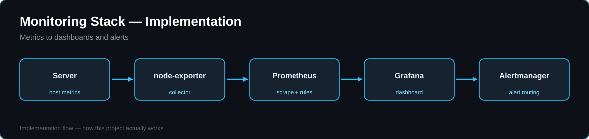

# Monitoring Stack — Prometheus + Grafana + Alertmanager




One-command observability for a Linux server or VPS: metrics collection, a ready Grafana dashboard, and alerts that fire before a full disk or dead service becomes an outage.

## Quick start

```bash
docker compose up -d
```

- Grafana → http://localhost:3000 (default admin/admin — change via `GRAFANA_ADMIN_PASSWORD`)
- Prometheus → http://localhost:9090
- Alertmanager → http://localhost:9093

## What's inside

- **Prometheus** scraping itself and **node-exporter** (host CPU, memory, disk, network) every 15s, 15-day retention
- **Alert rules** (`prometheus/alerts.yml`): instance down, CPU > 85%, memory > 90%, root disk > 85%
- **Alertmanager** routing/grouping alerts — add Slack/email/webhook receivers in `alertmanager/config.yml`
- **Grafana provisioning** — the Prometheus datasource and a Host Overview dashboard (CPU/memory/disk gauges + network traffic) load automatically, nothing to click-configure

## Extend it

- Monitor another server: add its `host:9100` to the `node` job in `prometheus/prometheus.yml`
- Monitor your apps: add a scrape job per service, or use exporters (postgres, nginx, redis...)
- Put Grafana behind the Nginx + HTTPS setup from my `vps-production-deploy` project for safe remote access

Built as a hands-on reference stack — the same monitoring baseline I set up for production servers.
